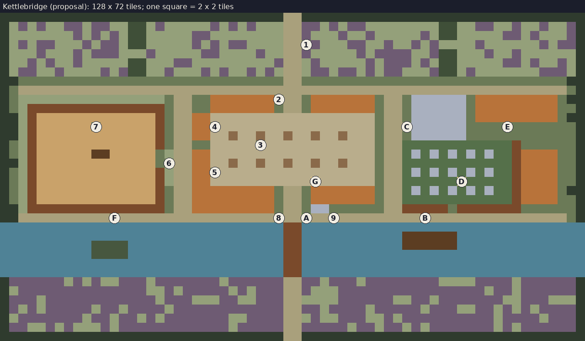

# Kettlebridge: the second area

- **Status:** Accepted by the lead on 2026-11-07: the theme (Q43 A, a
  market town on the river), the layout, the objective, the creatures and
  Duke as proposed below. Built in stages: the town and the bridge, then
  the creatures, then Duke (`docs/roadmap.md`). Nothing is built yet.
- **Binding constraints:** as Millbrook (`area-millbrook.md`): ADR-0005
  (no characters, environmental storytelling, objectives open areas),
  ADR-0010 (the cat stays at the base), ADR-0014 (top-down 3/4, no
  jumping), ADR-0016 (its own scene, joined at exits), `world.md` (one
  objective, one boss, safe ground at the entrance, rings of distance).
- **Related:** `story.md` (stage 2, the pattern, begins here), `enemies.md`
  (archetypes), `combat.md` (the lantern), `base.md` (the boss's heart opens
  the east pasture and the big barn).

Kettlebridge is the market town on the river Kett, south of Millbrook
across the ford. Drovers brought their cattle here; the barges came up
the river to its wharf; travellers from every valley stopped at the
coaching inn. It was taken a little after Millbrook, and it is the first
place where the player can start to see a **pattern** (`story.md`, stage
2): the notes here were written by people who had heard Millbrook went
quiet, and one traveller mentions a little grey cat on the Millbrook road.
The land round it has gone violet; its creatures are more changed than
Millbrook's and come in more kinds. The road on south crosses the river
by a lifting bridge, and the bridge is drawn up.

## What it should feel like

- **A busy place stopped.** Market day: the stalls set out on the square,
  a crate of eggs, the auction ring's sawdust raked, a barge tied up
  waiting for the bridge. Bigger than Millbrook, and emptier for it.
- **People had begun to worry.** Millbrook's notes are ordinary; here
  there is unease: the market notice asking after Millbrook's stallholders,
  lamps ordered for the church "all night now".
- **Harder.** More creatures, in more kinds, more changed: the town is
  further from the farm.
- **Lit at night, wrongly.** The church's windows still glow faintly at
  night, though no one has lit them (Proposal; an uncanny warm light in a
  dead town, never explained).

## The layout

North is up; the road from Millbrook's ford comes in at the top. The ground
is 128 × 72 tiles (about 3.2 by 3.2 screens at 16:9).



Each character below is 2 × 2 tiles (the picture shows the same map;
`images/make_kettlebridge.py` draws it and walks it):

```text
ttttttttttttttttttttttttttttttt==ttttttttttttttttttttttttttttttt
t,v,v,,vv,vv,,hh,v,,,,,v,v,v,,,==vv,v,vv,,,,,,,,hh,,vv,,v,,v,,vt
t,,,,,,,v,v,v,hh,,,,,vv,,,,,,,,==v,,,v,,v,,,,,v,hh,,,,,vv,v,,,vt
t,v,vv,,,v,vv,hh,,,,,v,v,vv,,,,==1v,,,vv,,v,,v,v,,,,v,,,,,,v,vvt
t,,,v,,,v,vvv,,,v,,,,,vv,,,,v,,==v,,,,,v,vvvv,,vhh,,,v,,v,,,,,,t
t,,v,v,,v,,,,,hh,,,vv,,,,,,,,,v==,v,,,,,v,vvv,v,hh,,,,,vv,v,,v,t
t,vv,,v,,,,v,vhh,,v,,,v,v,,v,v,==,vv,vv,v,vv,,,vhh,v,,,,,,,vvv,t
tt.............................==.............................tt
t.============================================================.t
t.,,,,,,,,,,,,,,,,.==..HHHHHHH2==.HHHHHHH.==.KKKKKK.HHHHHHHHH.tt
t.,###############.==..HHHHHHH.==.HHHHHHH.==.KKKKKK.HHHHHHHHH..t
tt,#OOOOOOOOOOOOO#.==HH__________________.==.KKKKKK.HHHHHHHHH.tt
tt,#OOOOOO7OOOOOO#.==HH4_________________.==CKKKKKK....E.......t
tt,#OOOOOOOOOOOOO#.==HH__k__k__k__k__k___.==.KKKKKK............t
t.,#OOOOOOOOOOOOO#.==.._____3____________.==qqqqqqqqqqqq#......t
t.,#OOOOOORROOOOO.,==HH__________________.==q+q+q+q+q+qq#HHHH..t
tt,#OOOOOOOOOOOOO.6==HH__k__k__k__k__k___.==qqqqqqqqqqqq#HHHH..t
t.,#OOOOOOOOOOOOO#,==HH5_________________.==q+q+q+q+q+qq#HHHH..t
t.,#OOOOOOOOOOOOO#,==HH___________G______.==qqqqqqDqqqqq#HHHH..t
t.,#OOOOOOOOOOOOO#.==HHHHHHHHH.==.HHHHHHH.==q+q+q+q+q+qq#HHHH.tt
t.,#OOOOOOOOOOOOO#.==HHHHHHHHH.==.HHHHHHH.==qqqqqqqqqqqq#HHHH..t
tt,###############.==HHHHHHHHH.==.ZZ......==#####.#######......t
tt==========F=================8==A==9=========B===============.t
~~~~~~~~~~~~~~~~~~~~~~~~~~~~~~~YY~~~~~~~~~~~~~~~~~~~~~~~~~~~~~~~
~~~~~~~~~~~~~~~~~~~~~~~~~~~~~~~YY~~~~~~~~~~~nnnnnn~~~~~~~~~~~~~~
~~~~~~~~~~iiii~~~~~~~~~~~~~~~~~YY~~~~~~~~~~~nnnnnn~~~~~~~~~~~~~~
~~~~~~~~~~iiii~~~~~~~~~~~~~~~~~YY~~~~~~~~~~~~~~~~~~~~~~~~~~~~~~~
~~~~~~~~~~~~~~~~~~~~~~~~~~~~~~~YY~~~~~~~~~~~~~~~~~~~~~~~~~~~~~~~
~~~~~~~~~~~~~~~~~~~~~~~~~~~~~~~YY~~~~~~~~~~~~~~~~~~~~~~~~~~~~~~~
tvvvvvv,v,v,,vvv,vvvvvvv,vvvvvv==vv,vvv,vvvvvvvv,,,,vvvv,vvvvvvt
t,vvvvvvvvvvvvvv,,v,vvvvv,v,vvv==v,,,vvvvvvvvvvvvvvvv,vv,vvvvvvt
tvvv,vvvvvvvvvvvv,vvv,,,vv,,vvv==,,,,vvvvvv,,vv,vvvvvvv,,vvv,,,t
tv,v,vvvvv,vv,vvvv,vvvvvvvvvvvv==vv,vvvv,vvvvv,vvv,,vv,v,v,vvvvt
t,vvvvvvv,vv,vv,v,vvvvvvv,,vvvv==,v,,vvv,,v,vvvvvvvvvv,vvvv,vvvt
tvv,,v,v,,,v,vvvvvvvvvvvv,vvvvv==vvvvv,vv,vv,v,vvvvvvv,v,vvvvvvt
ttttttttttttttttttttttttttttttt==ttttttttttttttttttttttttttttttt
```

| Key | What | Key | What |
|---|---|---|---|
| `t` | Woods (the edge, not walkable) | `h` | Field hedge |
| `.` `,` | Grass; long grass | `v` | Changed land, violet-tinged |
| `=` | Road, street, lane, towpath | `_` | The market square's cobbles |
| `H` | Houses, shops, the inn, the corn exchange | `k` | A market stall (left set out) |
| `K` | The church | `q` `+` | The churchyard; gravestones |
| `#` | Rails, walls | `O` `R` | The auction ring's sawdust; the auctioneer's rostrum |
| `~` | The river Kett | `Y` | The lifting bridge, drawn up |
| `Z` | The bridge's winch house | `n` | The barge, tied up |
| `i` | The island | 1–9, A–G | Places below |

Its own characters where Millbrook's mean something else (the
churchyard `q`, the winch house `Z`, the barge `n`), so both maps can be
read by the same code. At tile scale the ring is round, the stalls have awnings, and the streets
bend a little; the sketch only fixes what is where.

## Places

1. **The road in.** From Millbrook's ford, between fields going violet, to
   a milestone: "Kettlebridge 1". Safe ground (`world.md`).
2. **The top of the high street: the notice board.** A market notice and
   a note pinned over it (below).
3. **Arthur's egg stall.** Among the stalls on the square, a crate of eggs
   and a cash tin. **The winch house key** is in the tin (the objective).
4. **The chandler's.** Candles, lamp glass, a workbench. **The lantern**
   lies on the bench, half finished, in changed glass (Q35 C: until
   crafting exists, it is found here, as the bow is in Millbrook's cider
   shed). Changed candle glass and wax: the lantern's materials.
5. **The coaching inn.** Tables still laid; a traveller's diary in a room
   upstairs (one room inside, like Millbrook's cottages): **the first note
   of the pattern** (below).
6. **The inn yard and the ring's gate.** The back way into the auction
   ring, from the inn yard.
7. **The auction ring: Duke's ground.** The area's boss (below). Fenced,
   like Grist's yard, so the fight never spills out; the objective is not
   inside it.
8. **The bridge-keeper's door, by the toll house.** Arthur's note on the
   door (below); the toll ledger in the toll house.
9. **The winch house.** Locked. With the key, the winch lowers the bridge.
10. **A, the foot of the bridge.** The road runs to the river and stops:
    the bridge stands up in the air. **This is where the objective shows
    itself.**
11. **B, the barge at the towpath.** The *Marigold*, tied up, waiting for
    the bridge. Its cabin is locked: **a place to come back to**
    (`world.md`).
12. **C, the church.** The church door, flowers dead in their vases, a
    carving by the font (below). The bell tower's stair is broken: **a
    place to reach later.**
13. **D, the churchyard.** Gravestones, and things among them that are not
    gravestones (the Lichen-backs, below).
14. **E, the almshouses.** A row of small rooms; ordinary lives.
15. **F, the towpath by the island.** A willow island in the river with
    something glinting under it (a trinket, ADR-0005 point 10), seen from
    the towpath and reached later with an exploration upgrade.
16. **G, the seed merchant's stall.** Packets of seed: **new crop kinds**
    (`farming.md`: seeds come from adventures).

## The objective: lower the bridge

1. **See the problem** (A): the road ends at the river; the bridge is drawn
   up; the barge waits below it.
2. **Find out why** (8): Arthur's note on his door says he went up to the
   market and has the key with him.
3. **Fetch the key** (3): his egg stall in the middle of the square, where
   the market's creatures are thickest by day (fewer at night).
4. **Lower the bridge** (9): the winch house opens with the key; the bridge
   comes down over about ten seconds, played out on screen. The road south
   is open and stays open.

The boss is not on the way: Duke's ring is to one side, and the player can
lower the bridge without facing it (`world.md`).

## Creatures, zone by zone (Proposal)

New kinds, from the archetypes `enemies.md` sets aside for later areas,
more changed than Millbrook's (greys and violets over the browns):

| Creature | Archetype | Its one idea | The answer |
|---|---|---|---|
| **Market rats** | Swarmer that splits | A big rat splits into two small ones when hit hard | Finish them with sweeps; don't open with the heaviest hit |
| **Jackdaws** | Flyer that drops creatures | Carry a rat and drop it beside the player | Shoot them in the air (bow), or deal with what they drop |
| **River pike** | Artillery from water | Surface in the river and spit at a marked spot; out of reach in the water | Keep off the towpath's edge; arrows, or wait for it to beach after a spit |
| **Lichen-backs** | Ambusher among gravestones | Look like gravestones until close | Read the churchyard; bait the reveal |
| **Moths** (night) | Light-seeker | As in Millbrook, drawn to the church's light | As in Millbrook |

| Zone | By day | By night |
|---|---|---|
| The road in (1) | Nothing | Nothing |
| The high street (2) | One pack of rats | Moths at the church end |
| The market square (3, G) | Three packs of rats; two jackdaws over the stalls | Two packs of rats |
| The chandler's, the inn (4, 5) | Nothing (indoors is quiet) | Nothing |
| The churchyard (D) | Four Lichen-backs | Six Lichen-backs; moths at the windows |
| The towpath (8–B, F) | Two pike in the river | Three pike |
| The ring (7) | **Duke** | Duke |

About 35 creatures by day. The route teaches the new kinds in order:
splitting rats on the high street, then jackdaws over the square, then the
pike on the towpath, then the churchyard.

## Duke, the fair's champion bull: Kettlebridge's boss (Proposal)

- **Who:** the drovers' prize bull, a rosette still pinned to its halter,
  changed: its horns grown up and round into something like a crown. It
  holds the auction ring.
- **The arena:** the round ring of rails and raked sawdust, the
  auctioneer's rostrum (the one solid thing in the middle), two gates (from
  the pens, and from the inn yard), the pens beyond the rails.
- **Its idea, unlike Grist's:** Grist charges in lanes at walls; Duke
  **runs the ring.** Phase one: it circles the ring along the rails at
  speed (a moving danger round the edge), then cuts across at the player
  on a shown line; a cut that ends against the rostrum stuns it. It tosses
  with its horns (a big throw), and paws the sawdust into a cloud that
  hides where its next cut starts (listen, and watch its shadow).
- **Phase two:** it smashes the pens' gate and **the herd** comes in
  (changed cattle, Chasers), which it drives across the ring in a
  stampede line. The answer: the rostrum as cover, and breaking the herd
  before Duke's next run.
- **When it falls:** its heart opens **the east pasture and the big barn**
  at the farm (`base.md`); a horn (a material). It does not come back.
- Full values in `enemies.md` after acceptance.

## Notes in Kettlebridge (drafts)

The start of stage 2 (`story.md`): written by people who knew Millbrook
had gone quiet. Still nothing explains anything (rule 3).

> **Pinned over the market notice**
> Thursday market as usual. Millbrook stalls empty again. Has anyone heard
> from them? Ask at the Bell.

> **The traveller's diary, at the inn**
> Road from Millbrook quiet as the grave. Only company a little grey cat
> that kept pace with the cart half the way. Gave it the end of my pie.
> Wouldn't touch it.

> **Arthur's door, by the toll house**
> Gone up with the eggs. Key's in my tin at the stall if the barge comes
> before I'm back. — A.

The rest, in brief:
- **The toll ledger:** carts counted day by day; "Millbrook: none" three
  days running; then the counting stops.
- **The chandler's order book:** "40 tallow for the church. Vicar wants
  them lit all night now."
- **The carving by the font:** a church guide's card: "St Ketta and the
  Beast. The beast came down the valley hungry, and the saint fed it, and
  it slept." The carving shows a small animal with many eyes (stage 2; an
  old saint's story, explained innocently).
- **The almshouses:** a letter half written to a sister in another town.

## What Kettlebridge gives the player

| Kind | What | Comes back |
|---|---|---|
| Weapon | The lantern (magic), from the chandler's | Once |
| Materials | Changed candle glass and wax; rat tails, jackdaw feathers, pike scales, lichen; Duke's horn | Drops at 6:00 |
| Seeds | New crop kinds from the seed merchant's stall (G) | Found once |
| Farmland | Duke's heart: the east pasture and the big barn | Once |
| Notes | About eight | Found once |
| Trinket | One, on the island (F), reachable later | Found once |
| Progress | The bridge: the road south | Once |

## Not decided here

- The third area beyond the bridge: only its edge is drawn.
- Duke's values and the creatures' values (in `enemies.md` after
  acceptance).
- Interiors beyond one room each (the inn, the chandler's, the toll
  house).
- Whether the church's light at night stays (Proposal).
