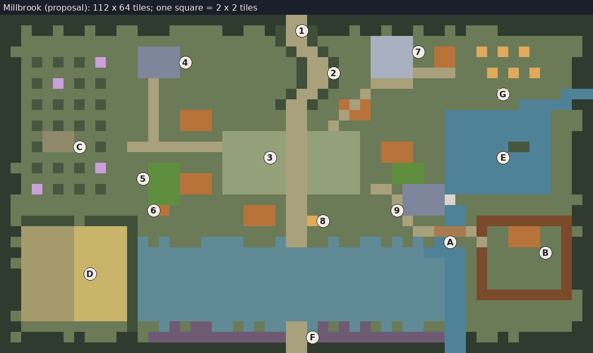

# The first area: Millbrook

- **Status:** Proposal (2026-10-11), for the lead. The layout, the
  creatures' placement and the objective are the lead's decisions
  (CLAUDE.md: level layout, balance); nothing here is built. Names are
  working names.
- **Binding constraints:** ADR-0005, ADR-0010, `story.md` (stage 1,
  "ordinary loss"), `art-direction.md`, `world.md` (shared rules for every
  area).
- **Open questions that change this area:** Q35 (what the player has when
  they first come here), Q36 (what happens when they fall), Q37 (how the
  objective is shown), Q32 (camera).

## In one paragraph

Millbrook is the hamlet in the valley below the farm, reached down a sunken
lane from the farm gate. It was the first place taken (`story.md`), so it is
the least changed: overgrown, quiet and still beautiful, with its people's
things exactly where they left them. The player comes here to forage, find
new seeds, learn to fight against weak changed wildlife, and read the first
notes. The road on south, to the next area, runs under floodwater: the
millpond has spilled over its bank because the mill's sluice gate is shut.
Opening it, with a crank the miller took home, drains the meadow and opens
the ford south. That is the area's objective.

## What it should feel like

- **Someone was here a moment ago.** The first area sets the game's
  storytelling rule: a table laid for breakfast, washing on a line, a
  scythe left standing in a half-cut field, a lesson still on the
  schoolroom board. No people, no bodies (`art-direction.md`).
- **Safe enough to learn in.** The creatures are weak and few, and hold
  small patches of ground. The first fight is optional and close to home.
  The hardest fight, the Old Boar, is the area's boss: the last thing on
  the way to the objective, and the first boss of the game.
- **Pretty by day, uneasy at night.** Daylight Millbrook is the gentlest
  place outside the farm. At night the windows stay dark, the night
  creatures come out, and only the fungus in the orchard glows.
- **A glimpse of what is coming.** Beyond the ford at the south edge, the
  grass has a violet tinge: the changed land starts there.

## The layout

North is up; the farm is above the top edge. The ground is 112 × 64 tiles
(about 2.8 by 2.8 screens at 16:9); walking straight across takes about 22
seconds.



Each character below is 2 × 2 tiles (the picture shows the same map):

```text
ttttttttttttttttttttttttttt==ttttttttttttttttttttttttttt
tt.tt.tt.tt..ttt.....tt..th=1httt.tt.tt.tt.t...ttttttttt
tt........................h==h.....KKKK................t
t............SSSS..........h==h....KKKK7.HH..e.e.e.....t
tt.a.a.a.*...SSSS4..........h==h...KKKK..HH...........tt
tt...........SSSS...........h==2...KKKK====...e.e.e...tt
tt.a.*.a.a....=.............h==h...====...............tt
tt............=............h==h...=............G.....~~~
tt.a.a.a.a....=...........h==h..H=H..............~~~~~tt
tt............=..HHH.......==...=HH.......~~~~~~~~~~...t
tt.a.a.a.a....=..HHH.......==..=..........~~~~~~~~~~...t
tt..PPP.......=......,,,,,,==,,,,,........~~~~~~~~~~..tt
tt.aPPPC.a..=========,,,,,,==,,,,,..HHH...~~~~~~ii~~..tt
tt...................,,,,3,==,,,,,..HHH...~~~~~E~~~~..tt
t..a.a.a.*....ggg....,,,,,,==,,,,,...ggg..~~~~~~~~~~..tt
tt...........5gggHHH.,,,,,,==,,,,,...ggg..~~~~~~~~~~..tt
tt.*.a.a.a....gggHHH.,,,,,,==,,,,,.==.MMMM~~~~~~~~~~..tt
t.............ggg..........==........=MMMMX............t
t.............6c.......HHH.==........9MMMM~~..........tt
t.hhhhhhhhhhh..........HHH.==s8.......=...~~.#########tt
ttuuuuuyyyyyh..............==..........==bbb=#..HHH..#.t
t.uuuuuyyyyyhw.w...wwww...w==..w..ww.w.w.~A..=..HHH..#tt
ttuuuuuyyyyyhwwwwwwwwwwwwwwwwwwwwwwwwwww~~w..#.....B.#tt
t.uuuuuyyyyyhwwwwwwwwwwwwwwwwwwwwwwwwwwwwww..#.......#tt
ttuuuuuyDyyyhwwwwwwwwwwwwwwwwwwwwwwwwwwwwww..#.......#tt
ttuuuuuyyyyyhwwwwwwwwwwwwwwwwwwwwwwwwwwwwww..#.......#tt
ttuuuuuyyyyyhwwwwwwwwwwwwwwwwwwwwwwwwwwwwww..#########.t
ttuuuuuyyyyyhwwwwwwwwwwwwwwwwwwwwwwwwwwwwww............t
t.uuuuuyyyyyhwwwwwwwwwwwwwwwwwwwwwwwwwwwwww............t
tt..........h..wv.vvww.w.ww==wv.vwv.w.ww..............tt
t.tttt.t...tt.vvvvvvvvvvvvv==Fvvvvvvvvvvvv..t..t.ttttttt
ttttttttttttttttttttttttttt==ttttttttttttttttttttttttttt
```

| Key | What | Key | What |
|---|---|---|---|
| `t` | Woods (the edge, not walkable) | `h` | Hedgerow |
| `.` `,` | Grass; the village green | `=` | Lane, road, path |
| `H` | Cottage | `K` | Chapel |
| `S` | Schoolhouse | `W` | (under marker 3) the well |
| `g` | Cottage garden | `c` | Hen coop |
| `a` | Apple tree (the orchard) | `P` | Cider press shed |
| `y` `u` | Standing wheat; cut stubble | `e` | Beehive |
| `~` | Brook, millpond, mill race | `M` `X` | Watermill; its sluice gate |
| `b` | Footbridge over the race | `#` | The miller's yard fence |
| `w` | Floodwater over the lower meadow | `v` | Changed land, violet-tinged |
| `i` | Island in the millpond | `*` | Glowing fungus (lights at night) |
| `s` | Signpost | 1–9, A–G | Places below |

## Places

1. **The lane from the farm.** A sunken lane between high hedgerows, down
   the hill.
   - The whole lane is safe ground (`world.md`: no creature within about
     20 tiles of the entrance from the farm).
   - The player arrives here from the farm gate and leaves the same way.
2. **The lost-pet poster.** On a fence post halfway down the lane: a hand-
   drawn tabby, "MISSING", a name, a reward.
   - The first note in the game, and an ordinary one: a lost cat in a
     village, nothing more (`story.md`, stage 1).
3. **The village green and the well.**
   - Five cottages around it.
   - Washing still on a line, a bicycle against a wall, a ball in the
     grass.
   - Most cottages can be entered (one room each): notes and small
     things to find.
4. **The schoolhouse.**
   - A lesson still on the board.
   - Children's drawings on the wall, one of them "my family" with a cat
     (`story.md`, stage 1).
   - An attendance register, half the morning ticked.
5. **A cottage garden: new seeds.**
   - Seed packets in a potting shed beside the vegetable beds gone to seed.
   - The first new crop kinds the player finds (`farming.md`: new seeds
     come from adventures; which crops is part of the crop design).
6. **The hen coop: the first animal** (Proposal).
   - A hen still living in a coop, plain and ordinary, not changed: the
     valley is barely touched.
   - The player can bring her home to the farm's pen (`base.md`).
   - How (carried, or following) comes with the animal design. If animals
     come later than Millbrook, the coop is simply empty until then.
7. **The chapel.**
   - A notice board: a harvest supper "next Sunday", a flower rota.
   - Flowers long dead in their vases.
   - The bell loft's ladder is broken: **a place to reach later**
     (`world.md`).
8. **The signpost into the water.** Where the south road meets the green,
   a signpost points down the road to the next place, and the road runs
   straight into floodwater. **This is where the objective shows itself**
   (below).
9. **The watermill and its sluice.**
   - Inside: a nest of changed field mice, the area's only fight indoors.
   - The miller's note pinned by the sluice wheel. The wheel turns with a
     crank, and the crank is missing.
   - From the mill's back door the sluice gate itself can be seen: stuck
     shut.
10. **A, the footbridge** over the mill race to the miller's yard.
11. **B, the miller's cottage and yard.**
    - The yard is the Old Boar's ground: **Millbrook's boss**. It can be
      avoided until the player is ready (below).
    - The sluice crank hangs inside the cottage, by the door.
12. **C, the orchard and the cider press shed.**
    - Apple trees in rows: forage every day.
    - The cider shed's tally board ("finish the north rows Thursday").
    - Changed crows by day; glowing fungus at night.
    - If Q35 C is chosen, the **orchard wood** for the bow is found here.
13. **D, the half-harvested wheat field.**
    - Half cut, half standing, the scythe left upright where its owner
      stopped.
    - A lunch cloth and a bottle at the field's edge.
    - Field mice in the standing wheat.
14. **E, the millpond island.** A willow and something glinting beneath
    it (a trinket; ADR-0005 point 10). It can be seen from the bank but
    not reached: **a place to come back to** with an exploration upgrade.
15. **F, the ford: the way south.**
    - Under water until the objective is done.
    - Beyond it the land is tinged violet, and the next area begins.
16. **G, the beekeeper's hives and hut.**
    - Honey to forage daily (a possible cooking ingredient).
    - The hive log: "Bees restless three days running. Took honey early."
      Ordinary, but uneasy.

## The objective: open the ford

The way on is shown by the world, not a quest log (Q37):

1. **See the problem.**
   - The south road runs into floodwater at the signpost (8).
   - The water comes from the millpond, plainly overflowing its low bank
     into the meadow (9).
2. **Find out why.**
   - In the mill (9), past the mice, the sluice wheel has no crank.
   - The miller's note says where it went: draft below.
3. **Fetch the crank.** It hangs in the miller's cottage (B), across the
   footbridge, in the Old Boar's yard. The player can sneak past the boar
   or fight it; beating it also opens the great fields at the farm.
4. **Open the sluice.**
   - Back at the mill, the crank fits and the sluice opens.
   - The brook runs back down the race, and the floodwater drains from
     the meadow over about ten seconds, played out on screen.
   - The road and the ford (F) are open, and stay open.

A first visit that does the objective takes about 30–45 minutes with
exploring. A player who knows the way can do it in a few minutes.

## Creatures (roles from `combat.md`; numbers are starting values)

Millbrook only has weak creatures. Their stats are tuned below the arena's
training creature; numbers come with the enemy design.

| Creature | Role | Where | When |
|---|---|---|---|
| **Changed field mice** | Swarmer: many, fast, little poise | Cottage gardens (5), the mill (9), the standing wheat (D); groups of 3–5 | Day |
| **Changed crows** | Skirmisher: keep away, swoop | The orchard (C) and the wheat field (D); 2–3 | Day |
| **The Old Boar** (boss) | Brute: high poise, a charge with a long telegraph | The miller's yard (B), alone | Day and night |
| **Night moths** (Proposal) | Swarmer that flies to light; weak, erratic | Over the green and the meadow | Night |

- **The Old Boar is Millbrook's boss** (the lead, 2026-10-11: each boss
  defeated opens more of the farm; `base.md`).
  - It teaches reading a big telegraph, stagger and the dodge.
  - Its yard is fenced, so the fight never spills into the rest of the
    area.
  - **Defeating it is not needed for the ford:** the crank can be taken
    while it is turned away, so the player is never forced into the
    hardest fight to move on.
  - **Defeating it gives back the farm's great fields:** it drops its heart,
    which opens the first overgrown parcel at the farm (`base.md`, Q38).
  - It is defeated once and does not come back (`world.md`).
- **Drops** are natural materials, changed (`story.md`, Q13): grey pelts,
  crow feathers, a boar tusk. Their uses come with crafting.
- **No creature spawns** on the lane, in the cottages, in the chapel or in
  the schoolhouse. Indoors is quiet, except the mill.

## Day and night

| | Day (6:00–20:00) | Night (20:00–6:00) |
|---|---|---|
| Creatures | Mice, crows, the Old Boar | Night moths, the Old Boar; mice and crows are gone |
| Light | Full | Sight about 7 tiles around the player (`world.md`); glowing fungus in the orchard; fireflies over the meadow (and over the floodwater) |
| Mood | Gentle, overgrown, birdsong thinning towards the south | Dark windows; the only warm things are notes and the player's own lights |

## Notes in Millbrook

About eight notes, all stage 1 (`story.md`: daily life cut short, nothing
pointing elsewhere; Millbrook is where the taking began, so its notes are
dated before any other area's). Short enough to read in one screen. Drafts
for the lead's taste, not final writing:

> **Pinned by the sluice wheel**
> Took the crank home again. The Abbott boys keep winding the gate for fun
> and the meadow floods. Pond's high, mind the low road. Crank's on the hook
> by my door if you need it. — T.

> **The lost-pet poster**
> MISSING. Pip, our tabby. Grey stripes, white paws, very friendly. Hasn't
> come home since Tuesday. Please check sheds. Reward. Ask at the
> schoolhouse.

> **Kitchen table, the cottage by the well**
> Gone to help Ted with the last of the wheat. Soup's on the stove. Back by
> dark.

The rest, in brief:
- **The schoolroom board:** the day's lesson, "The water cycle", half
  copied.
- **The chapel notice board:** the harvest supper, "next Sunday".
- **The cider shed's tally board:** barrels pressed, "finish the north rows
  Thursday".
- **The hive log:** the bees restless.
- **The miller's calendar:** days crossed off, then not.

None of them explains anything. Together they say only: an ordinary autumn
day, and then nobody. The poster and the drawing are the only cats, and
both are ordinary (`story.md` rules 3 and 4).

## What Millbrook gives the player

| Kind | What | Comes back |
|---|---|---|
| Forage | Apples (orchard), honey (hives), wild herbs along the hedgerows | At 6:00 |
| Seeds | New crop kinds from the cottage garden (5); possibly wheat from the field (D) | Found once |
| Materials | Changed drops (pelts, feathers, the tusk); orchard wood if Q35 C | Drops at 6:00 with the creatures |
| Animal | The hen (6), if animals exist by then | Found once |
| Farmland | The Old Boar's heart: opens the great fields at the farm | Once |
| Notes | About eight | Found once |
| Trinket | One, on the island (E), reachable later | Found once |
| Progress | The ford: the way to the second area | Once |

## Not decided here

- The second area beyond the ford: only its edge is drawn.
- Crop kinds behind the new seeds; crafting uses of the drops.
- Creature stats; the Old Boar's moves beyond "a long charge".
- Interiors of the cottages, beyond one room each.
- Audio: the area's ambience follows `audio-direction.md` (fewer birds to
  the south); prompts come with the area's art.
