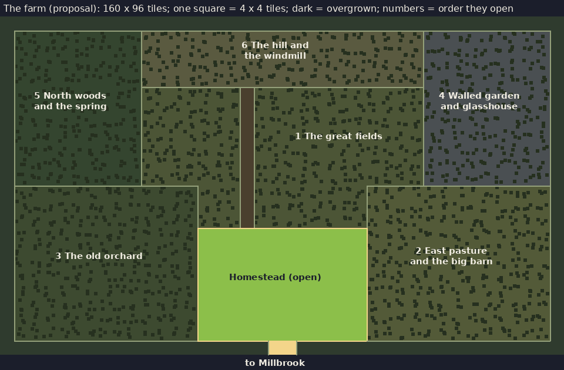
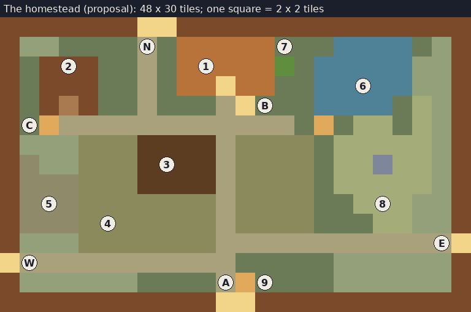
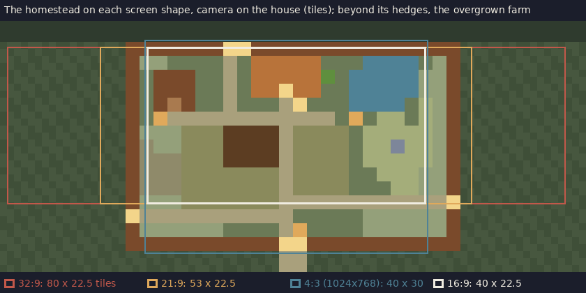

# The base: the farm

- **Status:** The lead decided on 2026-10-11 (Q33): **the farm is much
  bigger, but overgrown, and defeating bosses opens more of it.** Everything
  else here is a proposal for the lead: the layout is the lead's decision
  (CLAUDE.md, level layout). Nothing is built. The farm test scene
  (`scenes/farm/farm_test.tscn`) stays a test field until the layout is
  accepted.
- **Binding constraints:**
  - ADR-0005: the only place farming happens; peaceful; no combat.
  - ADR-0010: the pet lives here.
  - `farming.md`: Q21–Q27, all decided: the clock, farming by spells paid in
    Mana, the watering tiers up to rain, seeds without shops, the bed.
  - `art-direction.md`: the base is the one warm place; dusk is the
    emotional peak.
- **Decided by the lead (2026-10-11):**
  - Q38: a boss's heart lets Clear open its parcel, and the farm's
    backstory goes with it.
  - Q32: the camera follows with a dead zone (ADR-0015).
  - Q34: the gates are scene changes (ADR-0016).
  - Q28: farming spells glow warm, with a thread of violet at night.

## What the farm should feel like

- **A warm heart in a lost estate.** The player starts with the homestead:
  the house, a field, a pond, all tended and warm. Around it, behind every
  hedge, lies the rest of a much larger farm, swallowed by thicket.
- **The farm shows how far the player has come.** Every boss defeated out
  in the world gives back a piece of the farm. Adventuring progress is seen
  at home, every day.
- **Lived in, but by one person.** Everything in the house is sized for
  one farmer: one bed, one cup on the hook. A second chair at the table is
  there, pushed in, never used (a quiet touch, never explained).
- **Room to grow into, not to fill at once.** Mana, not land, limits how
  much the player farms in a day (`farming.md`). The farm is bigger than one
  day's Mana on purpose: the player chooses what to farm, and Mana upgrades
  grow into the land over the game.

## The whole farm

North is up. The farm is **160 × 96 tiles**, about four screens across and
four down at 16:9, inside a boundary of woods. Walking straight across takes
about 32 seconds (the player walks 5 tiles a second). The homestead sits at
the bottom centre, by the gate down to Millbrook.



Each character below is 4 × 4 tiles (the picture shows the same map). The
digits are the order in which the parcels open:

```text
tttttttttttttttttttttttttttttttttttttttt
t55555555566666666666666666666444444444t
t55555555566666666666666666666444444444t
t55555555566666666666666666666444444444t
t55555555566666666666666666666444444444t
t5555555551111111-111111111111444444444t
t5555555551111111-111111111111444444444t
t5555555551111111-111111111111444444444t
t5555555551111111-111111111111444444444t
t5555555551111111-111111111111444444444t
t5555555551111111-111111111111444444444t
t5555555551111111-111111111111444444444t
t3333333333333111-111111112222222222222t
t3333333333333111-111111112222222222222t
t3333333333333111-111111112222222222222t
t3333333333333hhhhhhhhhhhh2222222222222t
t3333333333333hhhhhhhhhhhh2222222222222t
t3333333333333hhhhhhhhhhhh2222222222222t
t3333333333333hhhhhhhhhhhh2222222222222t
t3333333333333hhhhhhhhhhhh2222222222222t
t3333333333333hhhhhhhhhhhh2222222222222t
t3333333333333hhhhhhhhhhhh2222222222222t
t3333333333333hhhhhhhhhhhh2222222222222t
tttttttttttttttttttGGttttttttttttttttttt
```

`t` woods (the edge), `h` the homestead, `-` an old track, `G` the gate
to Millbrook.

### The parcels

The farm is the homestead plus six overgrown parcels. **Each parcel opens
when the boss of one area is defeated**, in the order below: the first
area's boss opens the first parcel, and so on. The order is a proposal; it
puts what farming needs most first.

| Opens | Parcel (map digit) | Size (tiles) | What it holds | What it is for |
|---|---|---|---|---|
| Start | **The homestead** (`h`) | 48 × 30 | House, workshop, first field, pond, pen | Everything to start with (below) |
| 1st boss (Millbrook's Old Boar) | **The great fields** (`1`) | about 2,800 | Wide old fields in strips between hedgerows; the old track up the middle; a ruined field shelter | Crops at scale, once Mana allows |
| 2nd boss | **East pasture and the big barn** (`2`) | about 2,300 | Fenced pasture, a pond, the big barn (roof to mend) | Animals beyond the hen; hay |
| 3rd boss | **The old orchard** (`3`) | about 2,300 | Rows of old fruit trees, a cider shed, beehives | Fruit trees: forage that is planted once and picked every day |
| 4th boss | **Walled garden and glasshouse** (`4`) | about 1,600 | A walled kitchen garden, a broken glasshouse | Special crops: seeds from far areas that need shelter |
| 5th boss | **North woods and the spring** (`5`) | about 1,600 | Woodland, a spring, mushrooms in the shade | Timber and forage; the spring as a water feature |
| 6th boss | **The hill and the windmill** (`6`) | about 1,300 | A hilltop with an old windmill | Milling flour (cooking); the view over the whole world |

- **Each parcel gives back a building to restore** (the field shelter, the
  barn, the cider shed, the glasshouse, the windmill), so opening a parcel
  is more than more soil. What restoring needs comes with crafting.
- **Each parcel holds one trace of the farm's past** (Q38): an old
  almanac in the field shelter, initials carved in the barn door, a
  child's swing in the orchard. They are written by the farm's earlier
  generations (`story.md` rule 1: people from before, about their own
  lives), and they say the farm was once worked by many hands. That is
  why it is so big, and why one person could only keep the homestead.
- **The windmill comes last** because the hilltop is the one place the
  whole world can be seen from: every area the player has been to, and
  the far ones not yet visited. It is a story place for the end of the
  game (Proposal; `story.md`, stage 3).
- **More than six areas, or fewer:** if the world has more areas than
  parcels, the extra bosses open smaller pockets (a pond, a copse) inside
  the parcels. If it has fewer, two parcels open together. Decided with
  the world map.
- **The great fields are bigger than the first months need.** About
  2,800 tiles would take 5,600 Mana to till at today's costs. They are
  there to grow into with Mana upgrades and the rain spell, never to fill
  at once.

### How a parcel opens (Q38 C, decided 2026-10-11)

1. **Each boss drops its heart**, a piece of changed material unlike any
   other drop.
2. **At the farm, the player casts Clear on that parcel's thicket with the
   heart in the bag.** The heart is used up, and the whole wall of thicket
   withers back across the parcel in one long moment: a one-time event,
   with the camera following the withering.
3. **Inside, the ground is long grass and old field.** The ordinary Clear
   spell clears it a patch at a time, like the homestead's old fields.

**Thicket** is a hedge of bramble and young trees. It is drawn in the
farm's ordinary greens, not the changed land's violets: the farm's
overgrowth is neglect, not the calamity (`story.md`: the base is
untouched). Until its parcel opens, thicket cannot be walked into or
cleared.

**Clear** (Q38) is a farming spell from the start (`farming.md`). It turns
long grass into grass, 2 Mana per tile (starting value). With a boss heart, it opens that boss's parcel.

## The homestead

Everything the player starts with: 48 × 30 tiles inside a hedge, at the
bottom centre of the farm. The gate in its south hedge leads down to
Millbrook. Three more gates, north, west and east, lead into the parcels
and are blocked by thicket until those parcels open.



Each character below is 2 × 2 tiles (the picture shows the same map):

```text
#######GG###############
#,,....=.HHHHH...~~~~.,#
#.BBB..=.HHHHHA.~~~~~,,#
#.BBB..=.HHDHH..~~~~~,,#
#.BbB..=...=L...~~~~.f,#
#.s============.n.ff.f,#
#,,,:::TTTT=::::.fffff,#
#C,,:::TTTT=::::.ffoff,#
#PPP:::TTTT=::::.fffff,#
#PPP:::::::=::::..fff,,#
#PPP:::::::=::::...ff,,#
#,,,:::::::============G
G===========.....,,,,,,#
#,,,,,,....=m....,,,,,,#
###########GG###########
```

| Key | What | Key | What |
|---|---|---|---|
| `#` | Hedge and fence | `G` | Gates: south to Millbrook; north, west, east into the parcels (N, W, E in the sketch) |
| `.` | Grass | `,` | Long grass, walkable |
| `=` | Path | `H` `D` | Farmhouse and its door |
| `B` `b` | Workshop and its door | `s` | Storage chest |
| `T` | The first field (can be tilled from the start) | `:` | Old field under long grass (Clear, then till) |
| `~` | Pond | `n` | Bench by the pond |
| `A` | The old apple tree | `L` | Porch lamp |
| `P` `C` | Animal pen and coop (empty, broken) | `f` `o` | Wildflower meadow, a rock |
| `m` | Mailbox | | |

### What each place is for

Numbers and letters match the sketch.

1. **The farmhouse** (10 × 6 tiles). The door opens on one room (below).
   Its windows light up at dusk (already built in the test scene).
2. **The workshop.** Where crafting and weapon enhancement will happen
   (ADR-0005 point 7). Neither is designed yet; the building is reserved
   for them. The player's weapons hang inside on pegs.
3. **The first field: 8 × 6 tiles (48 tiles)**, next to the path and close
   to the door.
   - It can be tilled from the start.
   - That is more than one day's Mana can till and water at once
     (`farming.md`: Till 2 per tile, the first watering spell 4 per 4
     tiles; Mana 100), so the first days are about choosing what to plant.
4. **The old fields: about 180 more tiles** under long grass, west and
   east of the path. Cleared with the Clear spell a patch at a time from
   the start, then tilled. The first growth the player can make without
   leaving home.
5. **The animal pen and coop.**
   - Empty and broken at the start: their fence is down, the coop door
     hangs open.
   - The first animal can come from Millbrook (`area-millbrook.md`, the
     hen; Proposal).
   - Larger animals wait for the east pasture.
   - Animals are not designed yet; this is where they will live.
6. **The pond and its bench.**
   - The bench faces west, into the sunset: the place to watch dusk
     (`art-direction.md`, the emotional peak).
   - Nothing to do there but sit. Sitting fast-forwards the clock gently
     while the player watches, as a quiet alternative to sleeping through
     to morning (Proposal).
7. **The old apple tree.**
   - A forage tree: a few apples every day.
   - **The cat's tree**: one of the places it sits.
8. **The wildflower meadow.** Open ground with a rock, kept empty on
   purpose for small things later (a drying rack, a sign of each parcel
   opened).
9. **The mailbox** by the gate.
   - It is always empty. Interacting shows the empty box: no text.
   - It is one of the loneliest objects in the game, and it costs nothing.
   - Reserved for one uncanny story moment late on (Proposal; `story.md`).
10. **A, the south gate:** out to the lane and Millbrook.
11. **B, the porch lamp.** Lit at dusk with the windows.
12. **C, the storage chest:** outside the workshop, for materials.
13. **N, W, E, the parcel gates.**
    - North: the old track to the great fields.
    - West: to the old orchard.
    - East: to the east pasture.
    - Each opens onto a wall of thicket until its parcel is cleared. The
      walled garden, the woods and the hill are reached through the parcels
      next to them.

### The farmhouse inside (Proposal)

One room, about 12 × 8 tiles, entered by the door:
- **the bed** (sleep; `farming.md`);
- **the stove** (cooking, when it is designed; the cat treats are made
  here first);
- **the seed tin** (the starting seeds, catmint included; `farming.md`);
- **a table with two chairs**, one never used;
- **a basket by the stove** for the cat;
- **a window seat**, another of the cat's places.

From inside, the windows show the time of day.

## The pet's places

ADR-0010: the cat lives here and wanders. Its favourite spots in the
homestead:
- the porch step;
- the old apple tree;
- the pond bench (beside the player when they sit);
- the window seat;
- the basket by the stove;
- the top of the workshop roof.

**As parcels open, it finds new places**: the barn's hayloft, the
glasshouse's warm bench, and last the windmill's sails, where no cat could
be.

`story.md`'s small impossible things happen in these places, rarely: the
cat sitting in two of them a moment apart, a shadow that does not match
it. **The cat is always first into a newly opened parcel**: already
sitting there, waiting, when the thicket withers. Innocent, until it
isn't. Its behaviour is a separate design pass; the layout only gives it
the places.

## Light and the day

- **By day** the homestead is the warmest thing on screen: amber house,
  green crops, brown soil (`art-direction.md`). Opened parcels warm up as
  they are farmed; unopened thicket stays a dull, cool green.
- **At dusk** the windows and the porch lamp come on. The bench looks into
  the sunset, and the lane beyond the gate goes blue first.
- **At night** the warm lights stay untinted; the rest of the farm sits in
  the night colour (`farming.md`, "Light").
- **Rain** (the watering spell's final tier) falls over the whole farm,
  inside its boundary only (Proposal: the farm's own weather, a hint that
  the farm is not quite natural).

## On every screen (ADR-0015)



| Screen | Sees (tiles) | Around the house |
|---|---|---|
| 16:9 | 40 × 22.5 | Almost all of the homestead |
| 16:10 | 40 × 25 | Almost all of the homestead |
| 21:9 | 53 × 22.5 | All the homestead's width and the thicket beyond its hedges |
| 32:9 | 80 × 22.5 | All its width and 16 tiles of the overgrown parcels either side |
| 4:3 at 1x (1024×768) | 40 × 30 | All its height |

- **The farm is 160 × 96 tiles**, wider and taller than every screen, so
  the camera follows the player across it and stops at its edges
  (ADR-0015).
- Wide screens see thicket and unopened parcels beyond the homestead's
  hedges from the start: the size of what is still to be won back.

## Built later, in this order (Proposal)

1. **The farm layout**, replacing the test field:
   - the homestead (house, first field, pond, paths, the south gate);
   - the six parcels as thicket;
   - the gates as exits only, until Millbrook exists.
2. **The house inside** with the bed and the seed tin.
3. **The Clear spell** and the homestead's old fields.
4. **The pet** in its places (ADR-0010).
5. **Opening a parcel**: with the first boss (Millbrook's Old Boar).
6. **Then**, with their own design passes: the workshop's crafting, the
   stove's cooking, the pen's animals, restoring the parcels' buildings.

Nothing in this list is scheduled until the lead accepts the layout.
